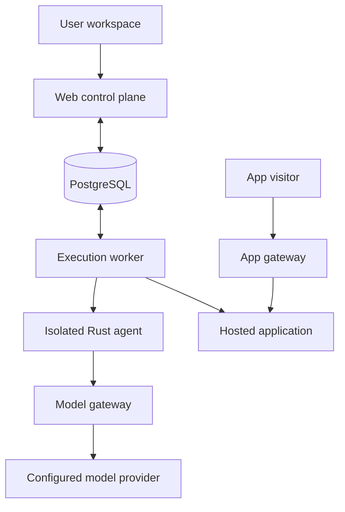

# Architecture

[Back to Latent Agent](../README.md)

Latent's implementation combines a web control plane with a Rust agent engine and server-side cloud execution. This document describes the application design at release 0.2.8. Each hosted installation needs its own operational verification.

| Layer | Technology and responsibility |
| --- | --- |
| Web interface | Next.js and React for conversations, agent settings, developer API, and deployment management. |
| Identity | Privy integration for verified account identity and session handling. |
| State | PostgreSQL for account-owned records, jobs, approvals and usage accounting. |
| Execution | A Rust agent engine handles model-directed tasks, files and tool activity. |
| Isolation | Docker and gVisor provide resource-bounded execution environments. |
| Models | A gateway connects compatible hosted or user-configured model providers. |
| Hosting | A dedicated application gateway routes assigned app addresses to running services. |

## The run lifecycle

A user selects an agent, model and run budget. The control plane validates the request and queues it. The worker executes the task, records activity, persists its results and settles usage. The user can review approval requests and inspect the result through the workspace.

## Operating boundaries

The control plane manages provider and integration credentials. Workloads are isolated, and approvals and account ownership are checked by the service. Hosted application traffic uses a distinct origin from the main workspace. Connected services and network-dependent functions require independent configuration and validation.

The reference deployment is a single-host architecture. This document does not imply multi-region failover, unlimited workload capacity or independent security certification.

See [NOTICE.md](../NOTICE.md) for the upstream engine attribution.

